# El taller de Norma

Tía Norma tiene 70, vende cerámica y solo usa WhatsApp. Acá no hay panel de admin: ella **llama a Goncy** para cambiar precios o sacar piezas, y **manda una foto por WhatsApp** cuando hay una nueva. Los compradores ven una sola página, grande y clara.

## 🏆 Ganador del challenge de la tía Norma

TiaNorma fue uno de los proyectos ganadores del challenge de [@goncy](https://x.com/goncy), revisado en vivo en Twitch por la abuela Bety (la tía Norma). Su veredicto: muy simple y fácil de usar, que era justo la idea.

[challenge original](https://x.com/goncy/status/2120275311028011449) · [stream en Twitch](https://twitch.tv/goncypozzo) · [mi hilo](https://x.com/pobletedev/status/2121989495172337958)

---

## Cómo lo usa Norma

Todo pasa en el simulador del celular: [`/telefono`](http://localhost:8787/telefono).

Al lado del teléfono hay una nota del sobrino. Cuatro cosas. Nada más.

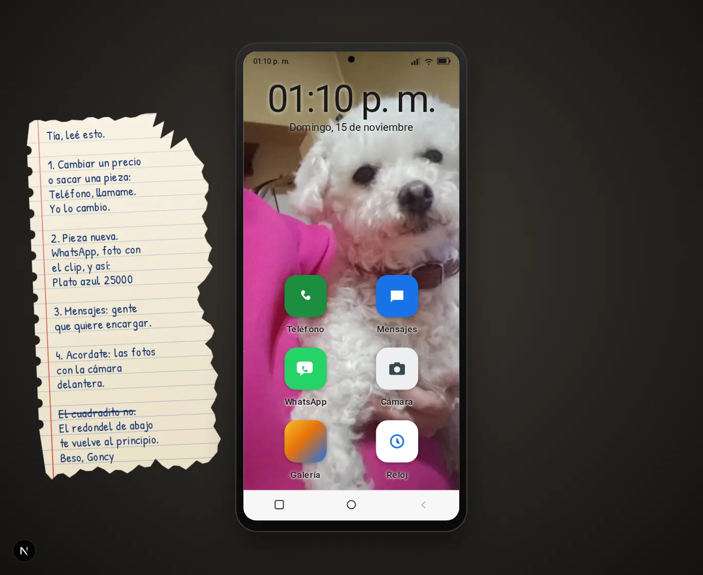

### 1. Cambiar un precio o sacar una pieza → llamada

Abre **Teléfono**, toca a Goncy.

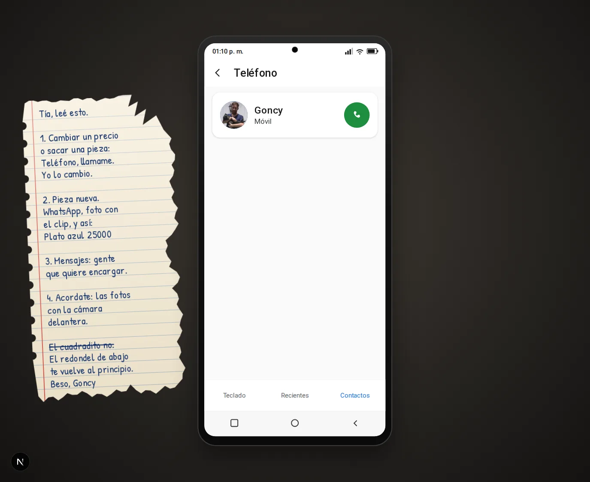

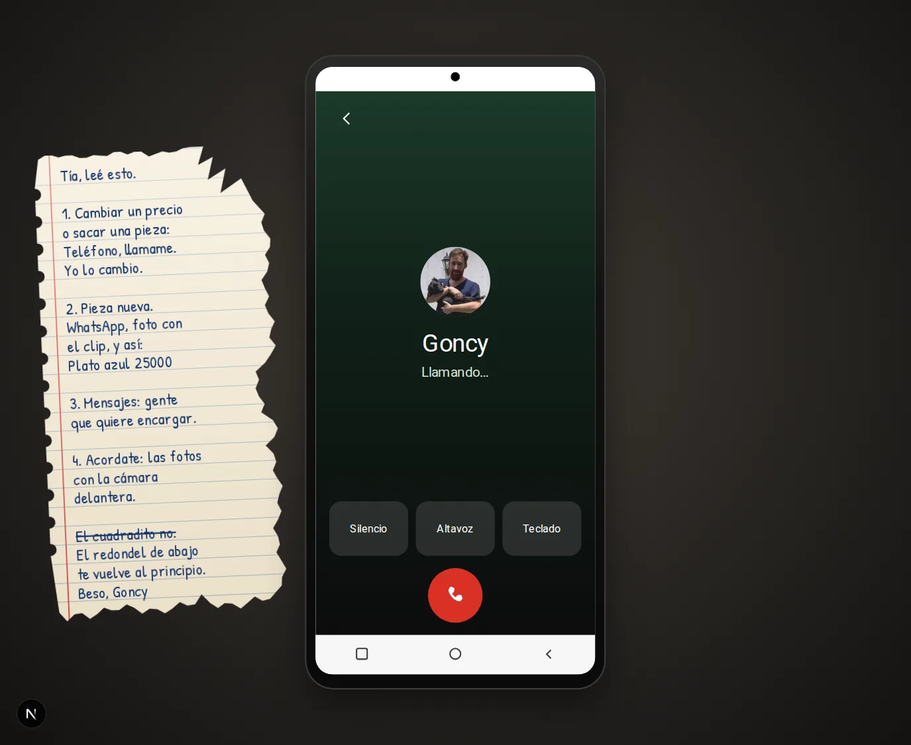

Goncy (voz en tiempo real) anota el cambio en el catálogo. Ella habla como hablaría por teléfono. Sin pantallas nuevas.

### 2. Pieza nueva → WhatsApp

Abre el chat con Goncy, toca el **clip**, elige la foto, escribe `nombre` + `precio` y manda.

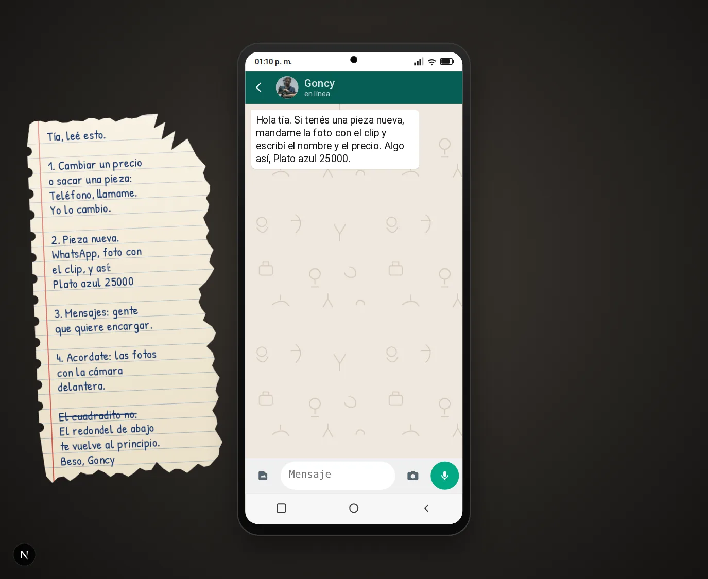

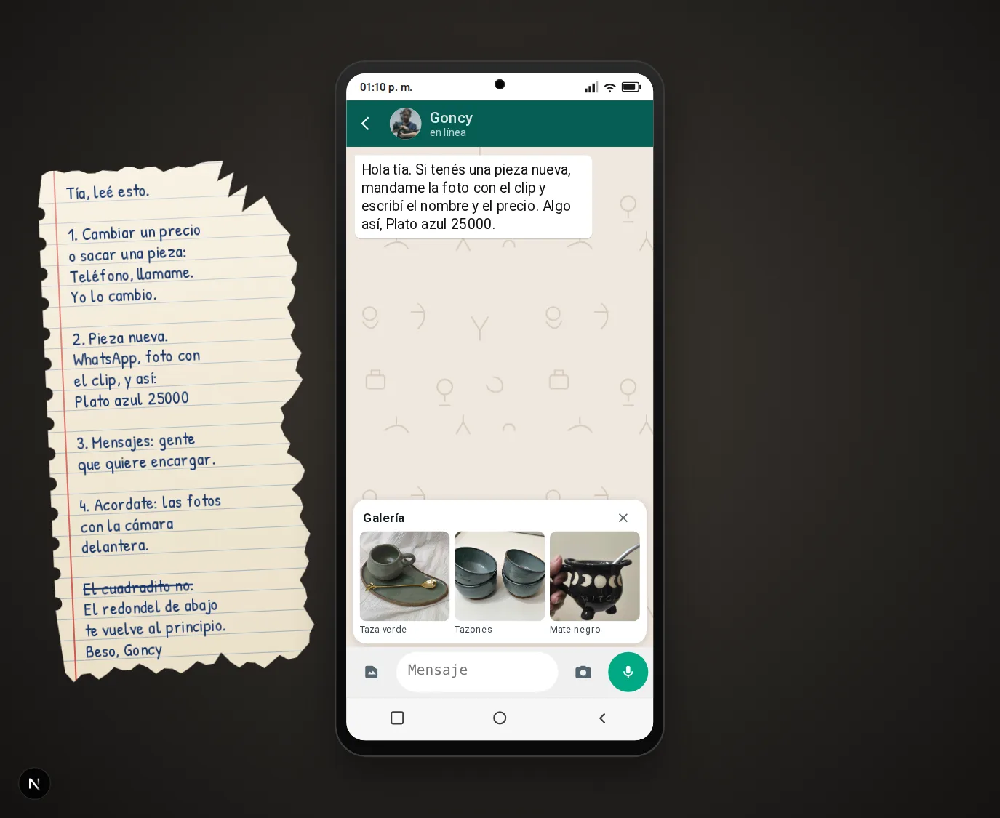

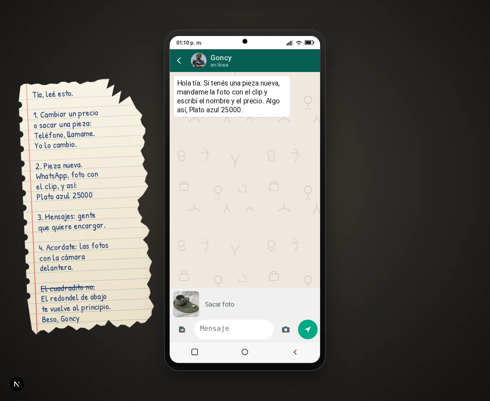

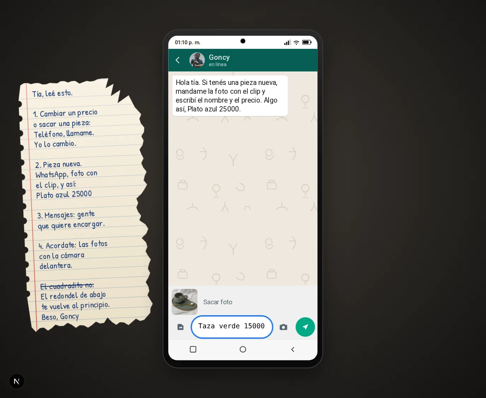

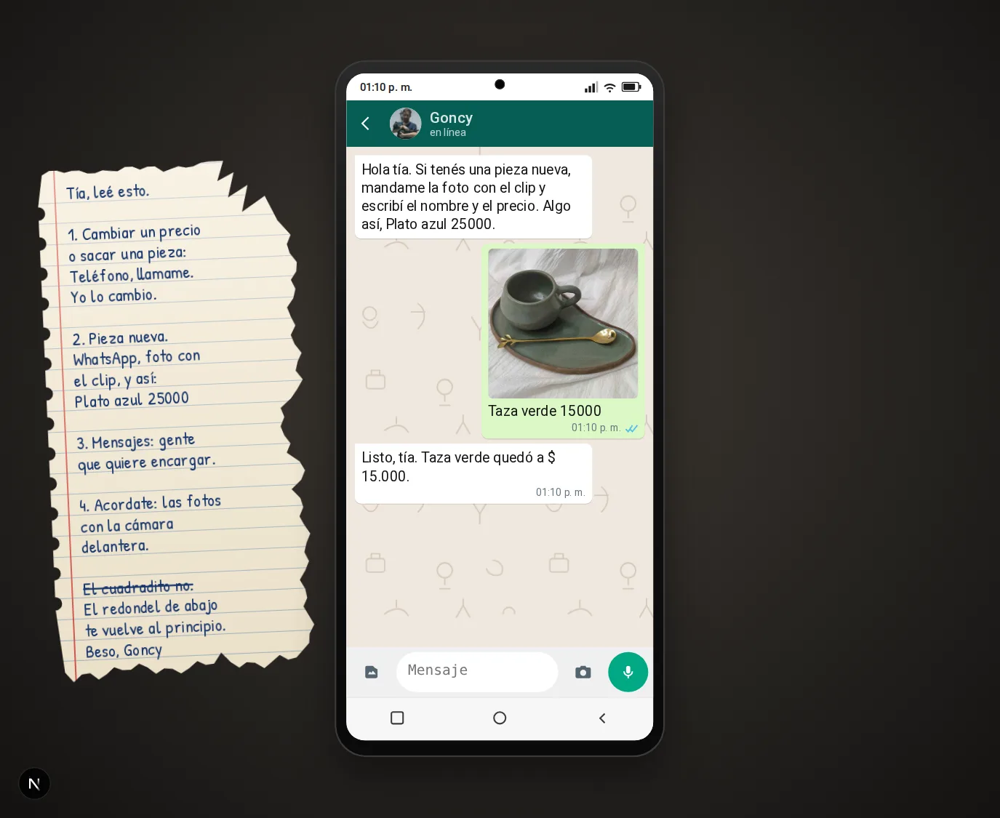

Ejemplo: `Taza verde 15000` → queda en la vitrina a `$ 15.000`.

### 3. Encargos → Mensajes

Los SMS del simulador son gente del barrio pidiendo piezas. Solo para que Norma sepa dónde mirar.

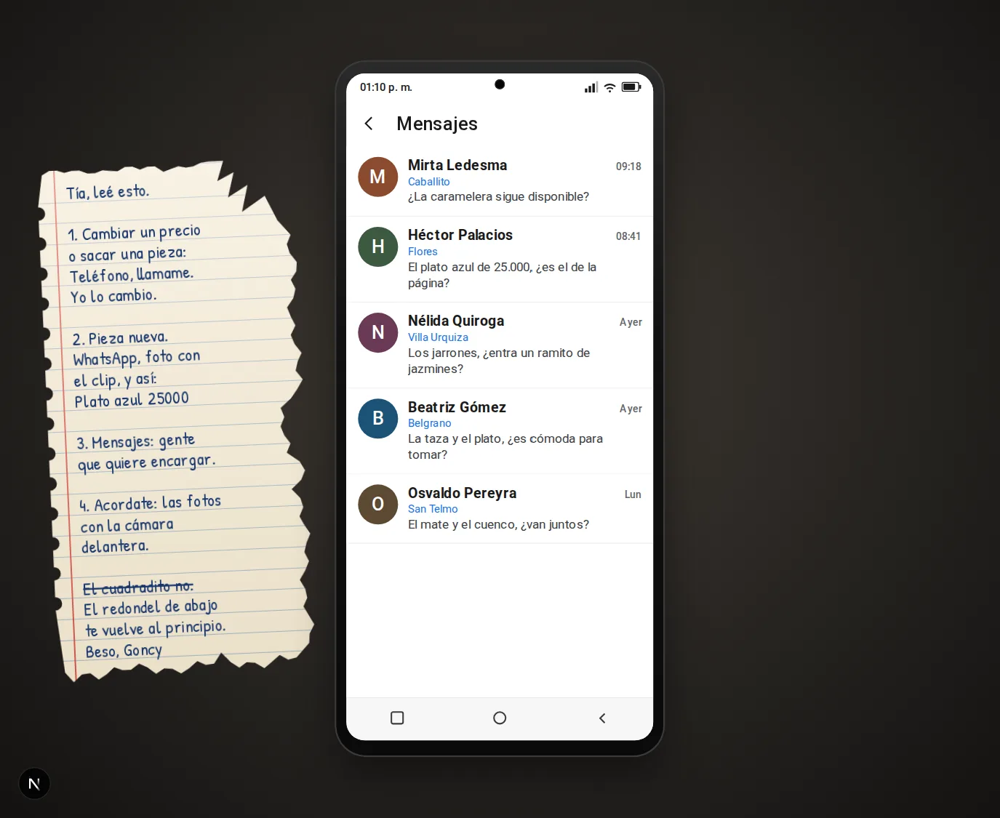

---

## Lo que ve el comprador

Una sola página: **El taller de Norma**. Foto grande, título, precio. Sin carrito. Sin botón de WhatsApp. Para encargar, el teléfono de arriba.

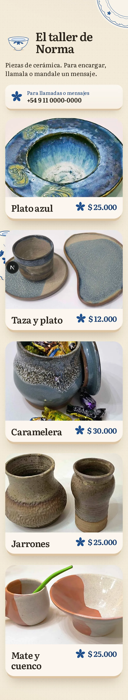

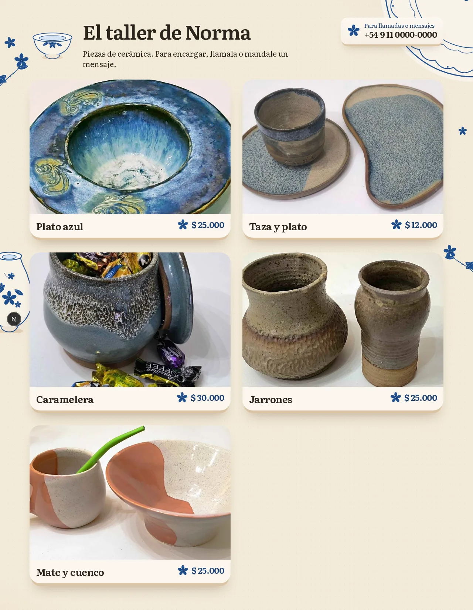

Si Norma carga una pieza nueva, aparece sola (la grilla se actualiza sola):

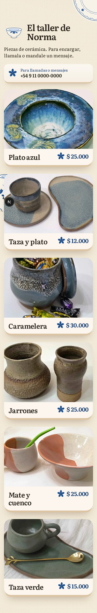

---

## Decisiones (y lo que NO hicimos)

- **El CMS es el celular que ya conoce.** No hay login, no hay mail, no hay dashboard.
- **Editar y borrar = llamada.** Construir otra UI para Norma sería pelear contra cómo vive. Goncy (el modelo de voz) tiene herramientas: precio, sacar, marcar vendido, reactivar.
- **Alta = foto + una línea de texto.** El formato es el mismo que le dejarías en un papelito.
- **Sin carrito, sin checkout, sin wa.me en la vitrina.** El brief pedía grilla + teléfono. Listo.
- **Simulador en `/telefono`.** WhatsApp y la llamada de verdad no se pueden probar en un PR: acá se prueban.
- **A propósito no hay:** panel web, roles, analytics, stock, variantes, pagos, notificaciones push, “admin mobile app”.

---

## Cómo probarlo

> **Link en vivo:** todavía no hay deploy público en el repo. Corrélo local.

| Qué | Dónde |
| --- | --- |
| Vitrina (comprador) | http://localhost:8787/ |
| Celular de Norma (simulador) | http://localhost:8787/telefono |
| Clave para la llamada | `AI_GATEWAY_API_KEY` o `VERCEL_AI_GATEWAY` en `.env.local` (Vercel AI Gateway → ElevenLabs realtime) |
| Persistencia (opcional) | `NORMA_DATABASE_URL` en `.env.local` — connection string de Postgres (Supabase → Project Settings → Database) |
| Credenciales de prueba | no hay login |

Sin la clave de Gateway, la vitrina y el alta por WhatsApp andan igual. La llamada a Goncy no: te va a decir que falta la env.

Sin `NORMA_DATABASE_URL`, el catálogo se guarda en `data/catalogo.json` (y las fotos en `data/piezas/`). Con la variable, va a Supabase (`norma.pieza`).

---

## Demo


https://github.com/user-attachments/assets/d6aa3c50-dd87-4692-b7b6-2ceb9702b52a


Ideal: Norma agrega una pieza por WhatsApp y después llama para cambiar un precio. Dos minutos, sin edición de código.

---

## Stack

- Next.js (App Router) + React
- Catálogo: Supabase Postgres si hay `NORMA_DATABASE_URL`; si no, archivo local (`data/catalogo.json`) + fotos en `data/piezas/`
- Alta por `POST /api/piezas` (multipart)
- Voz: Vercel AI Gateway + ElevenLabs realtime (`/api/call`, `/api/voz`)
- Semillas en `contenido/semillas/`

---

## Correr en local

```bash
npm install
# opcional — copiá .env.example a .env.local y completá lo que necesites:
# AI_GATEWAY_API_KEY=...          # solo para la llamada
# NORMA_DATABASE_URL=...          # Supabase (si no, usa data/ local)
npm run dev
```

Abre http://localhost:8787/ y http://localhost:8787/telefono. No hay migración en el repo: la tabla `norma.pieza` tiene que existir ya en el proyecto de Supabase.
